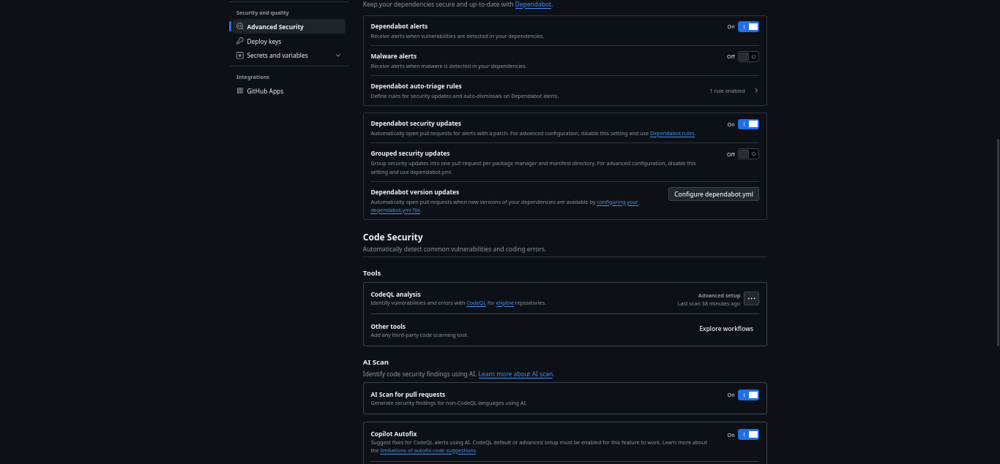
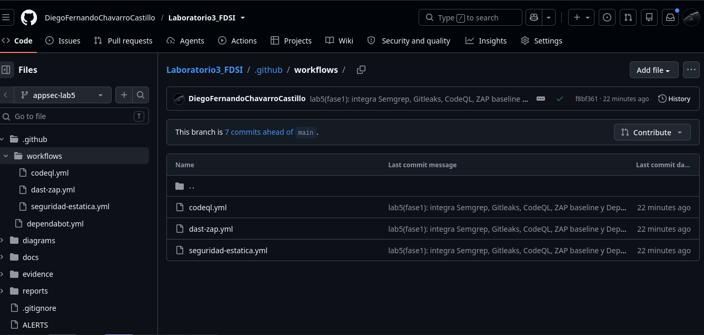
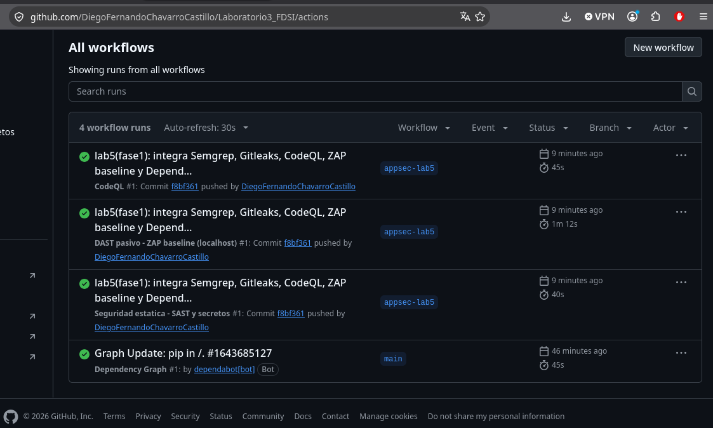
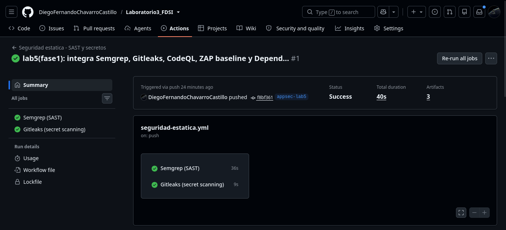
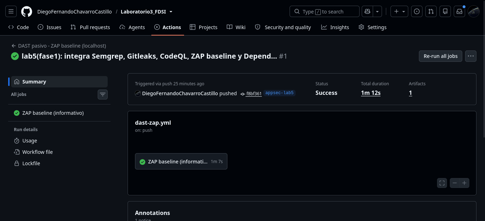
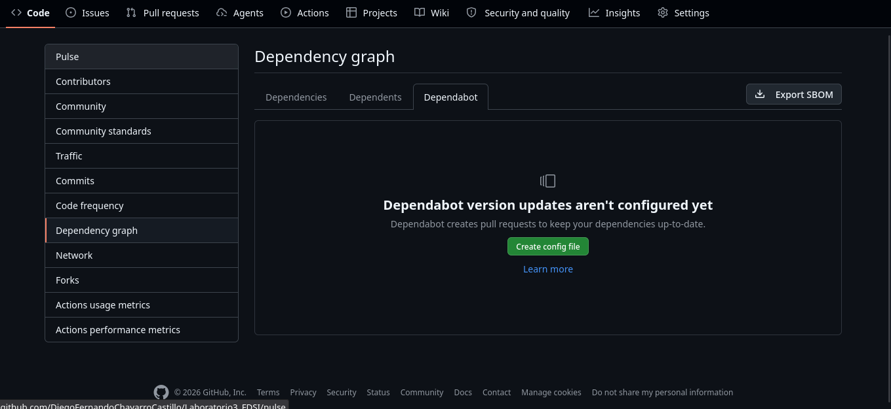

# 🛡️ Laboratorio 5 — Seguridad en el ciclo de desarrollo (AppSec / DevSecOps)

**Fundamentos de Seguridad de la Información (FDSI) — Escuela Colombiana de Ingeniería Julio Garavito**

| Campo | Valor |
|---|---|
| Integrantes | Juan Pablo Caballero · Diego Fernando Chavarro |
| Proyecto | MuvAutomation CrowdStrike Incident Hub (FastAPI + Uvicorn) |
| Repositorio | https://github.com/DiegoFernandoChavarroCastillo/Laboratorio3_FDSI |
| Rama del laboratorio | `appsec-lab5` (creada desde `lab04`) |
| Commit de línea base | `9edaac1` (`lab4-parte2: reverse engineering CTF ...`) |
| Herramientas | Semgrep, CodeQL (SAST) · Gitleaks (secretos) · Dependabot (SCA) · OWASP ZAP (DAST) |

## 🔒 Alcance y regla de entornos propios

- **Solo entornos propios.** Todas las pruebas dinámicas se hacen contra la aplicación del equipo ejecutándose en loopback (`http://127.0.0.1:8000`), ya sea en nuestra máquina o dentro del runner efímero de GitHub Actions.
- **Fuera de alcance:** sistemas de terceros, IPs o dominios ajenos, producción, datos reales, fuerza bruta, DoS y cualquier prueba destructiva.
- **Datos ficticios:** la app solo maneja alertas de ejemplo (`*.lab.invalid`, `10.10.10.0/24`). Ninguna credencial real se usa ni se publica.
- **Desviación declarada respecto al PDF:** el enunciado sugiere la rama `security/lab-fsi`; usamos `appsec-lab5`. No hay staging HTTPS propio, así que se usa la **alternativa local** que el PDF permite: ZAP baseline contra `127.0.0.1`.

## 📑 Tabla de contenido

1. [Fase 1 — Integración de herramientas en GitHub](#-fase-1--integración-de-herramientas-en-github-sast-secretos-sca-dast)
2. Fase 2 — Ejecución, triage y reporte de vulnerabilidades *(pendiente)*
3. Fase 3 — Pentesting controlado (solo localhost) *(pendiente)*
4. Fase 4 — Remediación y Pull Request *(pendiente)*
5. Fase 5 — Cierre e informe final *(pendiente)*

---

## 🧩 Fase 1 — Integración de herramientas en GitHub (SAST, Secretos, SCA, DAST)

### 🎯 Objetivo (con qué fin)

En DevSecOps la seguridad se integra al pipeline como un control automático que corre en cada `push` y en cada Pull Request, en vez de quedar como una auditoría al final. El objetivo es que todo cambio pase por cuatro miradas distintas y complementarias:

| Tipo | Herramienta | Qué mira | Cuándo actúa |
|---|---|---|---|
| SAST | Semgrep, CodeQL | El código fuente sin ejecutarlo (patrones y flujo de datos) | push / PR |
| Secretos | Gitleaks (+ GitHub secret scanning / push protection) | Claves y tokens en el **historial** de Git | push / PR |
| SCA | Dependabot | Versiones vulnerables en `requirements.txt` y en las acciones | Continuo, rama por defecto |
| DAST | OWASP ZAP baseline | La app **en ejecución** (respuestas HTTP reales) | push / PR |

### 🛠️ Qué hicimos

**1. Controles nativos de GitHub (Fase 0, verificados por API).** Hicimos un `GET` a `repos/{owner}/{repo}` y a `vulnerability-alerts`:

```text
dependabot_security_updates: enabled     secret_scanning: enabled
secret_scanning_push_protection: enabled vulnerability-alerts: HTTP 204 (habilitado)
code-scanning/default-setup: not-configured   -> usamos CodeQL en modo avanzado (workflow)
```

> CodeQL *Default setup* y el workflow avanzado son **excluyentes**. Como Default no estaba configurado, optamos por el workflow, que es versionable y revisable en un PR.

**2. Workflows creados (adaptados del kit a Python / `main:app` / puerto 8000 / `requirements.txt`):**

| Archivo | Jobs | Permisos por job (mínimo privilegio) |
|---|---|---|
| `.github/workflows/seguridad-estatica.yml` | `sast` (Semgrep), `secretos` (Gitleaks) | `contents: read` + `security-events: write` (SARIF) / `pull-requests: read` |
| `.github/workflows/codeql.yml` | `analyze` (python, `security-extended`) | `contents: read`, `actions: read`, `security-events: write` |
| `.github/workflows/dast-zap.yml` | `zap` (baseline pasivo contra la app en el runner) | `contents: read` |
| `.github/dependabot.yml` | Ecosistemas `pip` y `github-actions`, semanal | — |

**Disparadores comunes:** `push` a `appsec-lab5`, `pull_request` hacia `main` o `lab04`, y `workflow_dispatch` (ejecución manual).

**3. Buenas prácticas aplicadas y su motivo:**

- **`permissions:` a nivel de workflow en `contents: read`**, ampliado solo en el job que lo necesita. Si una acción de terceros se ve comprometida, el `GITHUB_TOKEN` tiene poco que robar o escribir.
- **Acciones fijadas por SHA de commit** (por ejemplo `actions/checkout@3d3c42e…  # v7.0.1`). Un tag puede moverse y un SHA no, así que esto mitiga ataques a la cadena de suministro como el de `tj-actions/changed-files` en 2025. Dependabot (`github-actions`) se encarga de proponer las actualizaciones de esos SHA.
- **Herramientas con versión fijada:** `semgrep==1.182.0`, `ghcr.io/gitleaks/gitleaks:v8.30.1` y `ghcr.io/zaproxy/zaproxy:2.17.0`. Así el resultado es reproducible.
- **`persist-credentials: false`** en `checkout`: el token no queda escrito en `.git/config`.
- **Gitleaks con `fetch-depth: 0`** y dos capas. La acción oficial (`gitleaks-action@v3`) revisa los commits del evento (push/PR). Además, el CLI recorre **todo el historial** con `--redact`, para que el reporte no reimprima el secreto. Como el repo es de **cuenta personal**, no requiere `GITLEAKS_LICENSE`. Los comentarios en PR están desactivados para no tener que pedir `pull-requests: write`.
- **Semgrep** con `p/python`, `p/owasp-top-ten`, `p/security-audit` y `p/secrets` (este último viene del kit), `--metrics=off`. Genera SARIF, que se sube a *Security → Code scanning* con la categoría `semgrep`, y JSON como artefacto (`resultado-semgrep`).

```yaml
# Fragmento — seguridad-estatica.yml
semgrep scan --config p/python --config p/owasp-top-ten \
  --config p/security-audit --config p/secrets --metrics=off \
  --sarif-output=semgrep.sarif --json-output=semgrep.json
```

**4. DAST en CI: la app se levanta dentro del runner.**

```yaml
# Fragmento — dast-zap.yml
- run: nohup uvicorn main:app --host 127.0.0.1 --port 8000 > uvicorn.log 2>&1 &
       # ... espera hasta 30 s a que /api/health responda
- run: docker run --rm --network host -v "$PWD/reports:/zap/wrk:rw" ghcr.io/zaproxy/zaproxy:2.17.0 \
         zap-baseline.py -t "$TARGET" -m 1 -I -r zap-report.html -J zap-report.json -w zap-report.md
```

- Un paso previo **valida que `TARGET` sea loopback** y aborta en cualquier otro caso. Es el mismo principio que el validador del kit, adaptado a `127.0.0.1`.
- El objetivo es `/api/alerts`, porque la app no tiene página raíz y `/docs` está desactivado desde el Lab 3. Así ZAP analiza una respuesta real del API.
- **Modo informativo:** usamos `-I` y el exit code de ZAP se guarda en `zap-exit-code.txt` sin romper el job. **¿Por qué?** El baseline es pasivo y en un primer pase produce sobre todo avisos de cabeceras (CSP, X-Content-Type-Options, etc.) que todavía no tienen triage. Si bloqueáramos el merge con avisos sin clasificar, el equipo aprendería a ignorar el control. Primero se hace el triage (Fase 2) y después se puede endurecer, por ejemplo con un archivo de reglas `-c` que marque como `FAIL` solo lo que ya se acordó corregir. **Un check verde no significa "app segura".**
- El reporte HTML/JSON/MD y el `uvicorn.log` se suben como artefacto `informe-zap`.

**5. Validación antes del push:**

- Parseamos los cuatro YAML con PyYAML (no hay `actionlint` en la máquina) y comprobamos que todas las acciones `uses:` estén fijadas por SHA de 40 caracteres.
- Probamos localmente el mismo comando de Gitleaks del workflow: `11 commits scanned … no leaks found`.

### 📌 Nota: Dependabot solo opera sobre la rama por defecto

Las **alertas** de Dependabot y las **version/security updates** se calculan sobre la rama por defecto del repositorio, que aquí es `main`. El `dependabot.yml` que agregamos en `appsec-lab5` **no tiene efecto hasta que llegue a `main`**. Cómo se evidencia:

- En *Insights → Dependency graph → Dependabot* no aparecen todavía los ecosistemas `pip` / `github-actions` configurados desde nuestra rama.
- El único workflow dinámico existente es `Dependency Graph` (`Graph Update: pip in /`), y corrió sobre `main`. Lo vimos con `gh run list`.
- La pestaña *Security → Dependabot alerts* refleja el `requirements.txt` **de `main`**.

**Qué cambia después del merge del PR:** Dependabot empezará a leer `.github/dependabot.yml`, abrirá PRs semanales de actualización para `pip` y para los SHA de las acciones, y recalculará las alertas con el `requirements.txt` resultante. El merge lo deciden los integrantes; este laboratorio no lo hace.

### 📸 Evidencia


*Demuestra que Dependabot alerts, Dependabot security updates, Secret scanning y Push protection están activos en el repositorio. Es el control nativo base sobre el que se apoya el resto del pipeline.*


*Los controles están versionados como código en `.github/`: cualquier cambio a ellos queda auditado en Git y pasa por PR.*


*GitHub reconoce los workflows de SAST + secretos, CodeQL y DAST, y los ejecuta automáticamente con el push.*


*Ejecución real de los jobs `sast` y `secretos` sobre `appsec-lab5`, con sus artefactos.*


*El análisis semántico de CodeQL para Python terminó y publicó resultados en Code scanning.*


*La app se levantó en el runner, respondió `/api/health` y ZAP generó el artefacto `informe-zap`.*


*Muestra que Dependabot trabaja sobre `main`: la configuración de nuestra rama todavía no aplica.*

### 🔎 Resultados e interpretación

> ⏳ *Pendiente: se completa con la salida real de `gh run list` / `gh run view` después del push.*
