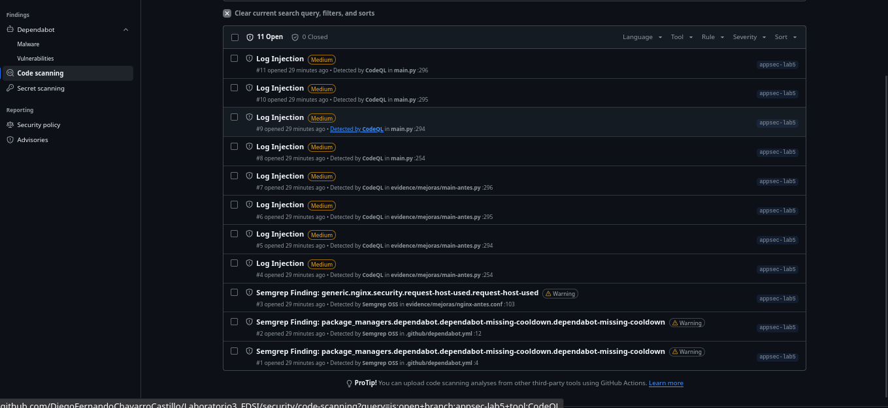
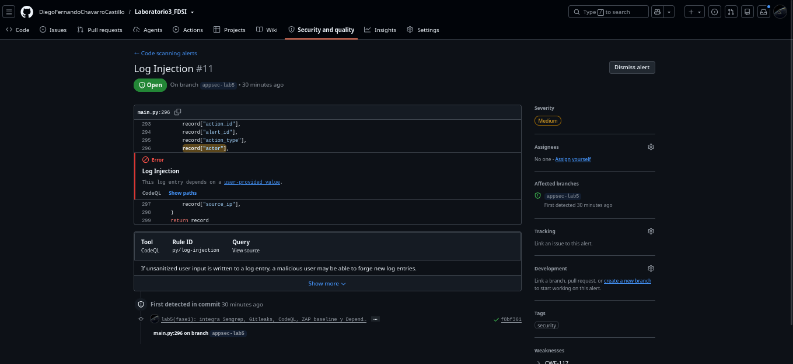
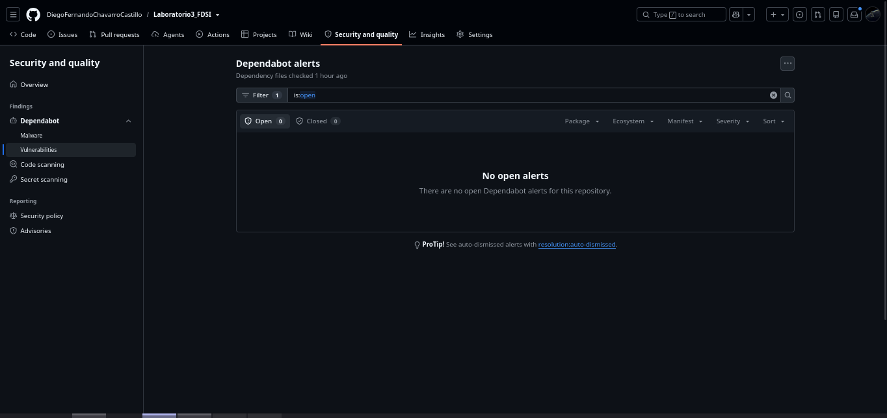
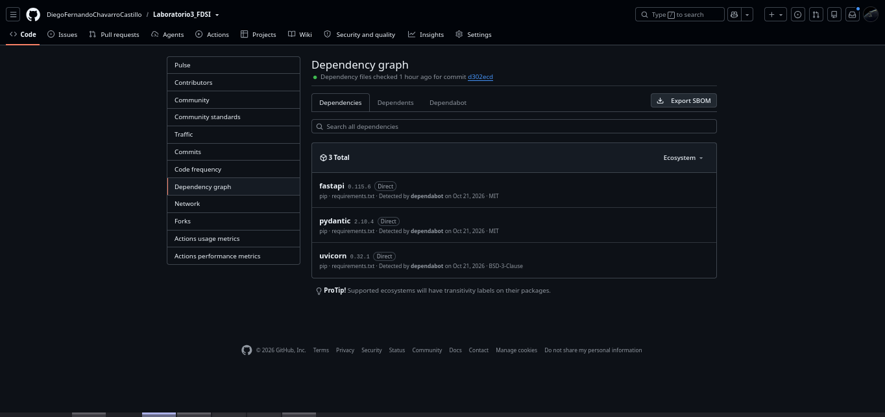
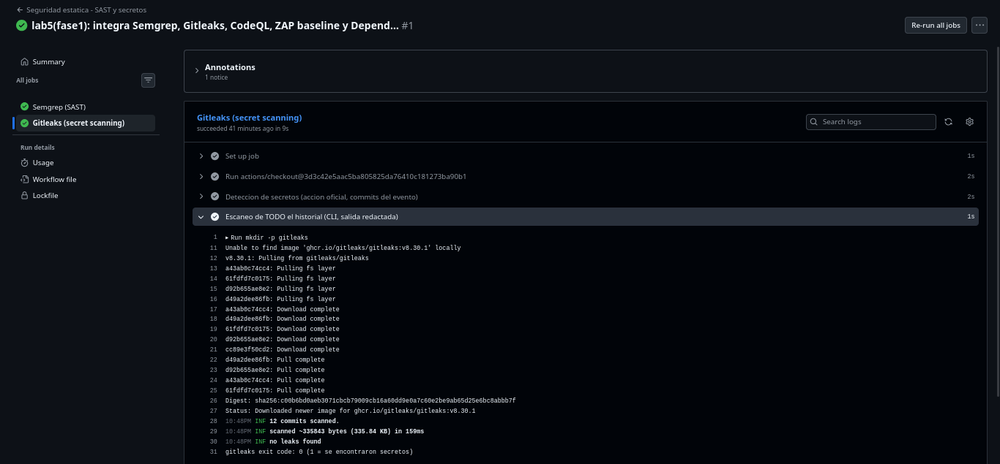
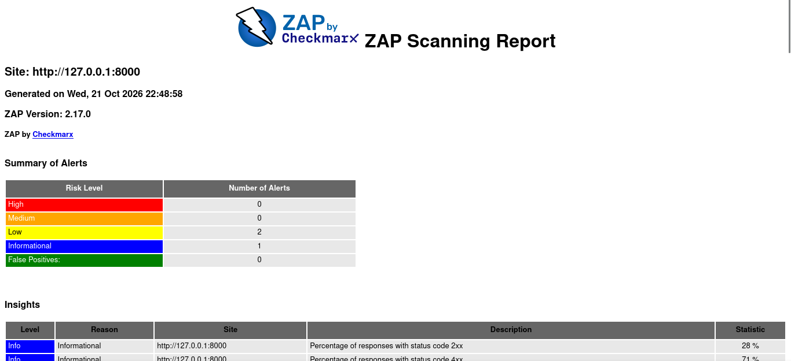
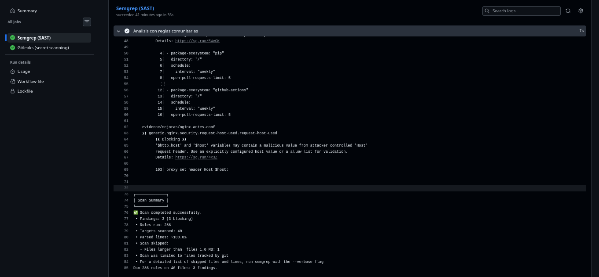

# 🛡️ Laboratorio 5 — Seguridad en el ciclo de desarrollo (AppSec / DevSecOps)

**Fundamentos de Seguridad de la Información (FDSI) — Escuela Colombiana de Ingeniería Julio Garavito**

| Campo | Valor |
|---|---|
| Integrantes | Juan Pablo Caballero · Diego Fernando Chavarro |
| Proyecto | MuvAutomation CrowdStrike Incident Hub (FastAPI + Uvicorn) |
| Repositorio | https://github.com/DiegoFernandoChavarroCastillo/Laboratorio3_FDSI |
| Rama del laboratorio | `appsec-lab5` (creada desde `lab04`) |
| Commit de línea base | `9edaac1` (`lab4-parte2: reverse engineering CTF ...`) |
| Herramientas | Semgrep, CodeQL (SAST) · Gitleaks (secretos) · Dependabot (SCA) · OWASP ZAP (DAST) |

## 🔒 Alcance y regla de entornos propios

- **Solo entornos propios.** Todas las pruebas dinámicas se hacen contra la aplicación del equipo ejecutándose en loopback (`http://127.0.0.1:8000`), ya sea en nuestra máquina o dentro del runner efímero de GitHub Actions.
- **Fuera de alcance:** sistemas de terceros, IPs o dominios ajenos, producción, datos reales, fuerza bruta, DoS y cualquier prueba destructiva.
- **Datos ficticios:** la app solo maneja alertas de ejemplo (`*.lab.invalid`, `10.10.10.0/24`). Ninguna credencial real se usa ni se publica.
- **Desviación declarada respecto al PDF:** el enunciado sugiere la rama `security/lab-fsi`; usamos `appsec-lab5`. No hay staging HTTPS propio, así que se usa la **alternativa local** que el PDF permite: ZAP baseline contra `127.0.0.1`.

## 📑 Tabla de contenido

1. [Fase 1 — Integración de herramientas en GitHub](#-fase-1--integración-de-herramientas-en-github-sast-secretos-sca-dast)
2. [Fase 2 — Ejecución, triage y reporte de vulnerabilidades](#-fase-2--ejecución-triage-y-reporte-de-vulnerabilidades)
3. Fase 3 — Pentesting controlado (solo localhost) *(pendiente)*
4. Fase 4 — Remediación y Pull Request *(pendiente)*
5. Fase 5 — Cierre e informe final *(pendiente)*

---

## 🧩 Fase 1 — Integración de herramientas en GitHub (SAST, Secretos, SCA, DAST)

### 🎯 Objetivo (con qué fin)

En DevSecOps la seguridad se integra al pipeline como un control automático que corre en cada `push` y en cada Pull Request, en vez de quedar como una auditoría al final. El objetivo es que todo cambio pase por cuatro miradas distintas y complementarias:

| Tipo | Herramienta | Qué mira | Cuándo actúa |
|---|---|---|---|
| SAST | Semgrep, CodeQL | El código fuente sin ejecutarlo (patrones y flujo de datos) | push / PR |
| Secretos | Gitleaks (+ GitHub secret scanning / push protection) | Claves y tokens en el **historial** de Git | push / PR |
| SCA | Dependabot | Versiones vulnerables en `requirements.txt` y en las acciones | Continuo, rama por defecto |
| DAST | OWASP ZAP baseline | La app **en ejecución** (respuestas HTTP reales) | push / PR |

### 🛠️ Qué hicimos

**1. Controles nativos de GitHub (Fase 0, verificados por API).** Hicimos un `GET` a `repos/{owner}/{repo}` y a `vulnerability-alerts`:

```text
dependabot_security_updates: enabled     secret_scanning: enabled
secret_scanning_push_protection: enabled vulnerability-alerts: HTTP 204 (habilitado)
code-scanning/default-setup: not-configured   -> usamos CodeQL en modo avanzado (workflow)
```

> CodeQL *Default setup* y el workflow avanzado son **excluyentes**. Como Default no estaba configurado, optamos por el workflow, que es versionable y revisable en un PR.

**2. Workflows creados (adaptados del kit a Python / `main:app` / puerto 8000 / `requirements.txt`):**

| Archivo | Jobs | Permisos por job (mínimo privilegio) |
|---|---|---|
| `.github/workflows/seguridad-estatica.yml` | `sast` (Semgrep), `secretos` (Gitleaks) | `contents: read` + `security-events: write` (SARIF) / `pull-requests: read` |
| `.github/workflows/codeql.yml` | `analyze` (python, `security-extended`) | `contents: read`, `actions: read`, `security-events: write` |
| `.github/workflows/dast-zap.yml` | `zap` (baseline pasivo contra la app en el runner) | `contents: read` |
| `.github/dependabot.yml` | Ecosistemas `pip` y `github-actions`, semanal | — |

**Disparadores comunes:** `push` a `appsec-lab5`, `pull_request` hacia `main` o `lab04`, y `workflow_dispatch` (ejecución manual).

**3. Buenas prácticas aplicadas y su motivo:**

- **`permissions:` a nivel de workflow en `contents: read`**, ampliado solo en el job que lo necesita. Si una acción de terceros se ve comprometida, el `GITHUB_TOKEN` tiene poco que robar o escribir.
- **Acciones fijadas por SHA de commit** (por ejemplo `actions/checkout@3d3c42e…  # v7.0.1`). Un tag puede moverse y un SHA no, así que esto mitiga ataques a la cadena de suministro como el de `tj-actions/changed-files` en 2025. Dependabot (`github-actions`) se encarga de proponer las actualizaciones de esos SHA.
- **Herramientas con versión fijada:** `semgrep==1.182.0`, `ghcr.io/gitleaks/gitleaks:v8.30.1` y `ghcr.io/zaproxy/zaproxy:2.17.0`. Así el resultado es reproducible.
- **`persist-credentials: false`** en `checkout`: el token no queda escrito en `.git/config`.
- **Gitleaks con `fetch-depth: 0`** y dos capas. La acción oficial (`gitleaks-action@v3`) revisa los commits del evento (push/PR). Además, el CLI recorre **todo el historial** con `--redact`, para que el reporte no reimprima el secreto. Como el repo es de **cuenta personal**, no requiere `GITLEAKS_LICENSE`. Los comentarios en PR están desactivados para no tener que pedir `pull-requests: write`.
- **Semgrep** con `p/python`, `p/owasp-top-ten`, `p/security-audit` y `p/secrets` (este último viene del kit), `--metrics=off`. Genera SARIF, que se sube a *Security → Code scanning* con la categoría `semgrep`, y JSON como artefacto (`resultado-semgrep`).

```yaml
# Fragmento — seguridad-estatica.yml
semgrep scan --config p/python --config p/owasp-top-ten \
  --config p/security-audit --config p/secrets --metrics=off \
  --sarif-output=semgrep.sarif --json-output=semgrep.json
```

**4. DAST en CI: la app se levanta dentro del runner.**

```yaml
# Fragmento — dast-zap.yml
- run: nohup uvicorn main:app --host 127.0.0.1 --port 8000 > uvicorn.log 2>&1 &
       # ... espera hasta 30 s a que /api/health responda
- run: docker run --rm --network host -v "$PWD/reports:/zap/wrk:rw" ghcr.io/zaproxy/zaproxy:2.17.0 \
         zap-baseline.py -t "$TARGET" -m 1 -I -r zap-report.html -J zap-report.json -w zap-report.md
```

- Un paso previo **valida que `TARGET` sea loopback** y aborta en cualquier otro caso. Es el mismo principio que el validador del kit, adaptado a `127.0.0.1`.
- El objetivo es `/api/alerts`, porque la app no tiene página raíz y `/docs` está desactivado desde el Lab 3. Así ZAP analiza una respuesta real del API.
- **Modo informativo:** usamos `-I` y el exit code de ZAP se guarda en `zap-exit-code.txt` sin romper el job. **¿Por qué?** El baseline es pasivo y en un primer pase produce sobre todo avisos de cabeceras (CSP, X-Content-Type-Options, etc.) que todavía no tienen triage. Si bloqueáramos el merge con avisos sin clasificar, el equipo aprendería a ignorar el control. Primero se hace el triage (Fase 2) y después se puede endurecer, por ejemplo con un archivo de reglas `-c` que marque como `FAIL` solo lo que ya se acordó corregir. **Un check verde no significa "app segura".**
- El reporte HTML/JSON/MD y el `uvicorn.log` se suben como artefacto `informe-zap`.

**5. Validación antes del push:**

- Parseamos los cuatro YAML con PyYAML (no hay `actionlint` en la máquina) y comprobamos que todas las acciones `uses:` estén fijadas por SHA de 40 caracteres.
- Probamos localmente el mismo comando de Gitleaks del workflow: `11 commits scanned … no leaks found`.

### 📌 Nota: Dependabot solo opera sobre la rama por defecto

Las **alertas** de Dependabot y las **version/security updates** se calculan sobre la rama por defecto del repositorio, que aquí es `main`. El `dependabot.yml` que agregamos en `appsec-lab5` **no tiene efecto hasta que llegue a `main`**. Cómo se evidencia:

- En *Insights → Dependency graph → Dependabot* no aparecen todavía los ecosistemas `pip` / `github-actions` configurados desde nuestra rama.
- El único workflow dinámico existente es `Dependency Graph` (`Graph Update: pip in /`), y corrió sobre `main`. Lo vimos con `gh run list`.
- La pestaña *Security → Dependabot alerts* refleja el `requirements.txt` **de `main`**.

**Qué cambia después del merge del PR:** Dependabot empezará a leer `.github/dependabot.yml`, abrirá PRs semanales de actualización para `pip` y para los SHA de las acciones, y recalculará las alertas con el `requirements.txt` resultante. El merge lo deciden los integrantes; este laboratorio no lo hace.

### 📸 Evidencia


*Dependabot alerts y Dependabot security updates en **On**. En *Code Security → CodeQL analysis* aparece **"Advanced setup"**, lo que confirma que GitHub reconoce nuestro workflow `codeql.yml` y que no hay un Default setup en conflicto.*


*Secret scanning y Push protection en **On**. El mismo estado quedó registrado por API en `evidence/appsec/raw/security-and-analysis.json` (`secret_scanning: enabled`, `secret_scanning_push_protection: enabled`).*


*Los controles están versionados como código en `.github/`: cualquier cambio a ellos queda auditado en Git y pasa por PR.*


*GitHub reconoce los workflows de SAST + secretos, CodeQL y DAST, y los ejecuta automáticamente con el push.*


*Ejecución real de los jobs `sast` y `secretos` sobre `appsec-lab5`, con sus artefactos.*


*El análisis semántico de CodeQL para Python terminó y publicó resultados en Code scanning.*


*La app se levantó en el runner, respondió `/api/health` y ZAP generó el artefacto `informe-zap`.*


*GitHub muestra **"Dependabot version updates aren't configured yet"** aunque `.github/dependabot.yml` ya existe en `appsec-lab5` (ver captura fase1-02). Es la prueba directa de que Dependabot solo lee la configuración de la rama por defecto (`main`).*

### 🔎 Resultados e interpretación

Primera ejecución, disparada por el push del commit `f8bf361` a `appsec-lab5` (salida de `gh run list` / `gh run view`):

| Workflow | Run ID | Job(s) | Estado | Duración | Artefactos |
|---|---|---|---|---|---|
| Seguridad estática - SAST y secretos | 39689070788 | Semgrep (SAST) · Gitleaks | ✅ success | 40 s | `resultado-semgrep`, `resultado-gitleaks`, `gitleaks-results.sarif` |
| CodeQL | 39689070950 | Analizar (python) | ✅ success | 45 s | (resultados en Code scanning) |
| DAST pasivo - ZAP baseline (localhost) | 39689070914 | ZAP baseline (informativo) | ✅ success | 1 m 12 s | `informe-zap` |

- **Ningún job en rojo.** Que estén en verde significa que **las herramientas se ejecutaron**, no que el código esté limpio. Semgrep y CodeQL publicaron 11 alertas entre los dos, y ZAP 3 avisos. El detalle va en la Fase 2.
- **Gitleaks hizo las dos capas:** la acción revisó `1 commits scanned` (el commit del evento) y el CLI revisó `12 commits scanned` (historial completo). Ambos dieron `no leaks found`. Así se demuestra que `fetch-depth: 0` sí entregó el historial completo.
- **ZAP:** la app respondió `{"status":"ok","version":"0.2.0-mejoras"}` en `/api/health` antes del escaneo. ZAP terminó con `FAIL-NEW: 0 WARN-NEW: 3 PASS: 64` y exit code 0, porque `-I` hace que los WARN no rompan el job.
- **Permisos efectivos:** el log del job `secretos` muestra `GITHUB_TOKEN Permissions: Contents: read, Metadata: read, PullRequests: read`, es decir, exactamente lo que declaramos.
- **Anotación del runner:** GitHub avisa que `ubuntu-latest` migra a Ubuntu 26. El log confirma `Image: ubuntu-26.04`. No afectó a ningún job.
- **Corrección posterior (Fase 2):** en la carpeta `reports/` del repo ya existía un reporte ZAP del Lab 3, y como `dast-zap.yml` escribía ahí, ese reporte viejo terminó dentro del artefacto `informe-zap`. Cambiamos la carpeta de salida a `zap-out/` para que el artefacto contenga solo el reporte de la ejecución actual.
- **Limitación:** ZAP baseline es pasivo y en este caso solo vio 6 URLs, porque el API no expone enlaces ni contrato OpenAPI. No prueba autenticación, inyección ni lógica de negocio. Eso se cubre en la Fase 3.

---

## 🔍 Fase 2 — Ejecución, triage y reporte de vulnerabilidades

### 🎯 Objetivo (con qué fin)

Una herramienta automática produce **señales**, no veredictos. En DevSecOps, el triage es el paso que convierte esa salida cruda en decisiones: confirmar qué es real, descartar con argumentos lo que no aplica, eliminar duplicados y priorizar según el **riesgo en este proyecto** (impacto × probabilidad). Si no hay triage, el pipeline termina en uno de dos extremos: se ignora todo, o se "arregla" ciegamente lo que no aplica.

### 🛠️ Qué hicimos

1. Confirmamos en solo lectura que los tres workflows corrieron sobre `appsec-lab5` (`gh run list`, Fase 1).
2. Descargamos los artefactos y los logs de cada job, y consultamos las APIs de GitHub (solo `GET`). Todo quedó en `evidence/appsec/raw/`:

| Archivo | Origen | Comando |
|---|---|---|
| `semgrep/semgrep.json`, `semgrep/semgrep.sarif`, `semgrep-job.log` | Semgrep 1.182.0 | `gh run download 39689070788 -n resultado-semgrep` |
| `gitleaks/gitleaks-historial.json`, `gitleaks-action-results.sarif`, `gitleaks-job.log` | Gitleaks 8.30.1 | `gh run download …` / `gh run view --job … --log` |
| `codeql-job.log`, `code-scanning-alerts.json` | CodeQL (`security-extended`) | `gh api repos/{o}/{r}/code-scanning/alerts?ref=refs/heads/appsec-lab5` |
| `zap/zap-report.{html,json,md}`, `zap/uvicorn.log`, `zap-job.log` | ZAP 2.17.0 | `gh run download 39689070914 -n informe-zap` |
| `dependabot-alerts.json`, `secret-scanning-alerts.json` | Dependabot / GitHub secret scanning | `gh api …/dependabot/alerts`, `…/secret-scanning/alerts` |
| `sbom-main.json` | Dependency graph (rama `main`) | `gh api …/dependency-graph/sbom` |
| `advisories-deps.json` | GitHub Advisory Database | `gh api "advisories?ecosystem=pip&affects=<pkg>@<ver>"` por cada paquete instalado |

3. Revisamos que las salidas crudas no contengan secretos: buscamos patrones de tokens de GitHub, claves AWS, llaves privadas y cabeceras `Authorization`, y no hubo coincidencias. Los únicos `***` son el enmascarado del propio GitHub Actions.
4. Para cada alerta leímos la línea de código señalada y verificamos si el dato que la dispara puede contener de verdad algo malicioso.

### 📊 Resumen de lo que reportó cada herramienta (salida real)

| Herramienta | Resultado crudo | Tras deduplicar |
|---|---|---|
| CodeQL | 8 alertas `py/log-injection` (4 en `main.py`, 4 en `evidence/mejoras/main-antes.py`) | 4 ubicaciones únicas → 1 real + 3 falsos positivos |
| Semgrep | 3 hallazgos en 40 archivos con 286 reglas (2 `dependabot-missing-cooldown`, 1 `request-host-used`) | 2 hallazgos |
| Gitleaks | 0 secretos (1 commit del evento + 12 commits del historial) | — |
| GitHub secret scanning | 0 alertas (`[]`) | — |
| Dependabot | **0 alertas** | (ver APPSEC-06: falso negativo) |
| Advisory DB (consulta manual) | `starlette 0.41.3`: 6 advisories. Los otros 11 paquetes instalados: 0 | 1 hallazgo agrupado |
| ZAP baseline | 3 WARN (10021, 90004, 10049), 0 FAIL, 64 PASS | 3 hallazgos |

> **Sobre `main_reducir_exp_a_API.py`:** esperábamos ver duplicados de `main.py`, pero ninguna herramienta reportó nada en ese archivo, porque no tiene llamadas a `logger`. Los duplicados reales salieron en `evidence/mejoras/main-antes.py`, que es una copia histórica del backend versionada como evidencia del Lab 3. Sus 4 alertas (#4–#7) coinciden línea a línea con las de `main.py` (#8–#11), así que las tratamos como duplicadas.

### 📋 Tabla de hallazgos

Escala de severidad: **Crítica / Alta / Media / Baja / Informativa**. El *contexto* de la app pesa en la valoración: es un prototipo de laboratorio con datos ficticios, **sin autenticación** y expuesto solo en red local.

| ID | Herramienta | Regla | Archivo:línea | Descripción | OWASP 2021 / CWE | Severidad | Justificación del riesgo (impacto × probabilidad en *este* proyecto) | Estado |
|---|---|---|---|---|---|---|---|---|
| APPSEC-01 | CodeQL (#11; dup. #7) | `py/log-injection` | `main.py:296` | El campo `actor` de `POST /api/actions` (texto libre, 1–64 caracteres) se escribe en el log sin neutralizar. Un `\n` permite fabricar líneas de log falsas | A09 Security Logging and Monitoring Failures / CWE-117 | **Media** | **Impacto medio:** el log con `rid` es justamente el control de atribución que construimos en M2/M3 del Lab 3, y falsificarlo permite inventar o esconder acciones. **Probabilidad alta:** el endpoint no tiene autenticación y basta un JSON con `"\n"`. No toca confidencialidad | Abierto (inferido; se valida en Fase 3) |
| APPSEC-02 | CodeQL (#8, #9, #10; dup. #4–#6) | `py/log-injection` | `main.py:254`, `:294`, `:295` | El análisis de flujo marca `alert.id`, `action.alert_id` y `action.action_type` como dato de usuario que llega al log | A09 / CWE-117 | Informativa | **Falso positivo, argumentado:** `alert.id` se valida con el patrón `^ALRT-[A-Z0-9]+-\d{4}$`, y Pydantic v2 usa el motor regex de Rust, donde `$` es fin de texto y no admite `\n`. `alert_id` solo se loguea **después** de comprobar que existe en `ALERTS`, y todos esos IDs pasaron el mismo patrón. `action_type` es un `Enum` cerrado. CodeQL no modela las restricciones de Pydantic | Falso positivo (se confirma con una prueba en Fase 3) |
| APPSEC-03 | Semgrep (#1, #2) | `dependabot-missing-cooldown` | `.github/dependabot.yml:4`, `:12` | Sin `cooldown`, Dependabot propone versiones recién publicadas. Si se publica un paquete malicioso, se propondría de inmediato | A08 Software and Data Integrity Failures / CWE-829 | Baja | **Impacto alto en teoría** (cadena de suministro). **Probabilidad baja:** el PR de Dependabot igual requiere revisión y merge humano, y hoy el archivo solo actúa sobre `main`. Las dos alertas son la misma regla (una por ecosistema) | Abierto (candidato de corrección barata en Fase 4) |
| APPSEC-04 | Semgrep (#3) | `nginx…request-host-used` | `evidence/mejoras/nginx-antes.conf:103` | `proxy_set_header Host $host` reenvía al backend un `Host` que controla el cliente | A07 Identification and Authentication Failures / CWE-290 | Informativa | El archivo es una **copia histórica** del Lab 3: no se despliega y el repo no tiene `nginx/` activo. Aunque se desplegara, el backend no toma decisiones de seguridad con `Host` y solo usa `request.url.path` para el log (`main.py:204`). Se relaciona con APPSEC-06 (GHSA-86qp) | Falso positivo en contexto |
| APPSEC-05 | ZAP (10021) | X-Content-Type-Options Header Missing | `GET /api/alerts` | La respuesta no envía `X-Content-Type-Options: nosniff` | A05 Security Misconfiguration / CWE-693 | Baja | La respuesta es JSON con `Content-Type: application/json`, así que el *MIME sniffing* tiene poco efecto práctico. Es defensa en profundidad. En el Lab 3 Nginx agregaba esta cabecera, pero **la app sola no lo hace** | Abierto (candidato Fase 4) |
| APPSEC-06 | Advisory DB (manual) / Dependabot | GHSA-7f5h-v6xp-fcq8, GHSA-82w8-qh3p-5jfq, GHSA-wqp7-x3pw-xc5r, GHSA-86qp-5c8j-p5mr, GHSA-x746-7m8f-x49c, GHSA-2c2j-9gv5-cj73 | `requirements.txt` → `fastapi==0.115.6` → `starlette 0.41.3` (transitiva) | 6 vulnerabilidades conocidas en Starlette (3 altas CVSS 7.5, 3 medias) que **Dependabot no reporta** | A06 Vulnerable and Outdated Components / CWE-1395 | Baja | **Aplicabilidad verificada en el código:** no usamos `StaticFiles`, `FileResponse`, `request.form()`/multipart ni `HTTPEndpoint`, que es donde están los vectores de 5 de las 6. La sexta (Host → `request.url.path`) solo afecta una línea de log (`main.py:204`), no una decisión de acceso. El riesgo es **latente**: aparece si el código empieza a usar esas APIs. **No se puede subir `starlette` sola** porque `fastapi 0.115.6` exige `starlette<0.42.0`. Hay que subir FastAPI y hacer pruebas de regresión | Abierto (riesgo aceptado / plan de actualización) |
| APPSEC-07 | ZAP (90004) | Cross-Origin-Resource-Policy Header Missing | `GET /api/alerts` | No se envía `Cross-Origin-Resource-Policy` | A05 / CWE-693 | Baja | Mitiga la lectura cruzada de recursos (ataques tipo Spectre o XS-Leaks) desde otros orígenes en el navegador. Es un API sin cookies ni sesión, así que el impacto es bajo | Abierto (candidato Fase 4, mismo cambio que APPSEC-05) |
| APPSEC-08 | ZAP (10049) | Storable and Cacheable Content | `/`, `/api`, `/api/alerts`, `/robots.txt`, `/sitemap.xml` | Sin `Cache-Control`, un proxy intermedio podría guardar las respuestas | A04 Insecure Design / CWE-524 | Informativa | Los datos son ficticios y la proyección pública ya excluye `agent_id`, `internal_ip` y `analyst_email` (M1 del Lab 3). Relevante si el API llegara a servir datos reales | Abierto |

**Lo que las herramientas NO detectaron:** la **ausencia total de autenticación** en `GET/POST /api/alerts` y `/api/actions`, documentada desde el Lab 3, es el riesgo más alto de la app (A01 Broken Access Control / CWE-306). Ningún SAST lo marca, porque no hay una "línea vulnerable", y el baseline pasivo de ZAP no lo prueba. Se valida manualmente en la Fase 3.

### 🧪 Gitleaks: sin hallazgos (resultado válido)

Gitleaks no encontró secretos ni en el commit del evento ni en los 12 commits del historial (`gitleaks-historial.json` = `[]`). GitHub secret scanning tampoco tiene alertas. En particular, **`evidence/` no contiene secretos detectables**, lo cual importa porque ahí hay PCAP, logs y salidas de nmap de los labs anteriores. Que no haya hallazgos no prueba que no existan secretos: solo dice que nada coincide con las ~200 reglas de Gitleaks, que buscan formatos de proveedores conocidos y entropía.

### 📌 SCA: por qué Dependabot dice "0" y aun así hay vulnerabilidades

- `sbom-main.json`, el grafo de dependencias que usa Dependabot, solo contiene **`fastapi@0.115.6`, `pydantic@2.10.4` y `uvicorn@0.32.1`**, que son los tres paquetes declarados en `requirements.txt`. Las dependencias transitivas (`starlette`, `h11`, `anyio`, …) no aparecen porque no hay *lockfile*.
- Las versiones realmente instaladas salen del log del job ZAP (`Successfully installed … starlette-0.41.3 …`). Las cruzamos contra la GitHub Advisory Database y obtuvimos 6 advisories, todas de `starlette`.
- **Conclusión:** es un **falso negativo de configuración**, no un fallo de Dependabot. Dependabot ve lo que el manifiesto declara. La mitigación de fondo es fijar las transitivas con un lockfile (por ejemplo `pip-compile` → `requirements.txt` con hashes), para que el SCA vea el árbol completo.
- Siguiendo el PDF ("no actualice a ciegas"), **no subimos versiones** en esta fase. Primero verificamos si el código usa las funciones afectadas (ver APPSEC-06).

### 📸 Evidencia


*"11 Open · 0 Closed" en la rama `appsec-lab5`: 8 *Log Injection* (Medium) de CodeQL y 3 *Semgrep Finding* (Warning). Los dos SAST quedaron centralizados en la pestaña Security gracias a la subida del SARIF de Semgrep.*


*CodeQL resalta `record["actor"]` en `main.py:296` (regla `py/log-injection`, CWE-117, detectada por primera vez en el commit `f8bf361`). "Show paths" muestra el flujo desde el cuerpo de la petición hasta `logger.info`. Es APPSEC-01, que validamos en la Fase 3.*


*Dependabot reporta 0 alertas. Esta captura sola daría una falsa sensación de seguridad. Comparar con la siguiente.*


*"3 Total": `fastapi`, `pydantic` y `uvicorn`, todas *Direct*, y `starlette` no aparece. La cabecera dice "Dependency files checked … for commit `d302ecd`", que es el HEAD de `main` y no de nuestra rama. Esto explica el falso negativo de APPSEC-06 y confirma de nuevo que el SCA opera sobre la rama por defecto.*


*`12 commits scanned … no leaks found`: el historial completo se revisó y no hay secretos expuestos.*


*Resumen del reporte: sitio `http://127.0.0.1:8000`, ZAP 2.17.0, **High 0 · Medium 0 · Low 2 · Informational 1**. Las dos Low son APPSEC-05 y APPSEC-07 y la Informational es APPSEC-08, todas contra la app levantada en el runner.*


*`Ran 286 rules on 40 files: 3 findings`: alcance del análisis y número de hallazgos crudos antes del triage.*

### 🔎 Resultados e interpretación

- **De 24 señales crudas a 8 hallazgos.** Las 24 son 8 de CodeQL, 3 de Semgrep, 6 advisories y 7 instancias de ZAP (1 + 1 + 5). Tras deduplicar quedan 8 hallazgos: **1 Media, 4 Baja y 3 Informativas**, con 2 de ellas marcadas como falsos positivos argumentados. Ninguno es Crítico ni Alto **en este contexto**.
- **El hallazgo automático más relevante es APPSEC-01 (log injection en `actor`),** porque ataca directamente el control de trazabilidad que el equipo construyó en el Lab 3.
- **Falsos positivos observados:** 3 de las 4 ubicaciones de CodeQL (no modela las validaciones de Pydantic) y la regla de Nginx de Semgrep (archivo de evidencia que no se despliega). Una mejora posible es excluir `evidence/` del análisis (`paths-ignore` en CodeQL y `--exclude` en Semgrep) para reducir ruido. Hoy duplica 4 alertas.
- **Falso negativo observado:** Dependabot (APPSEC-06), por la falta de lockfile.
- **Lo que esta fase NO prueba:** que los hallazgos "inferidos" sean explotables (eso se valida en la Fase 3), ni la ausencia de vulnerabilidades de lógica o de control de acceso, que ningún escáner de este pipeline evalúa.
